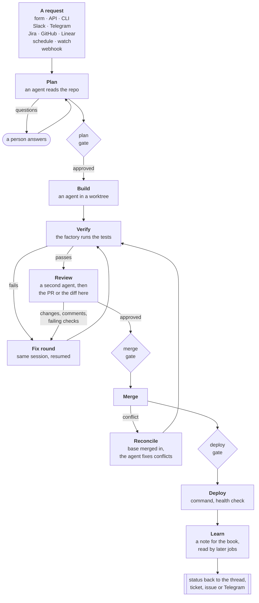
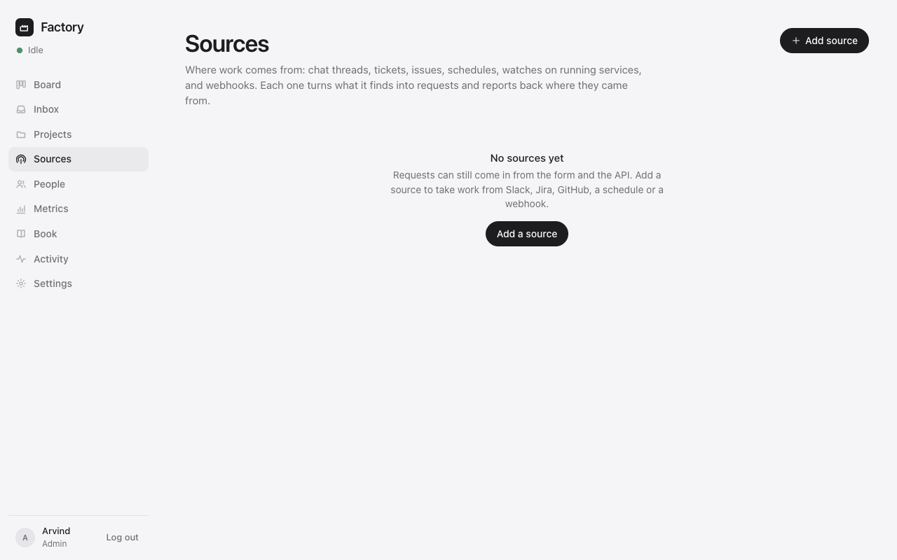
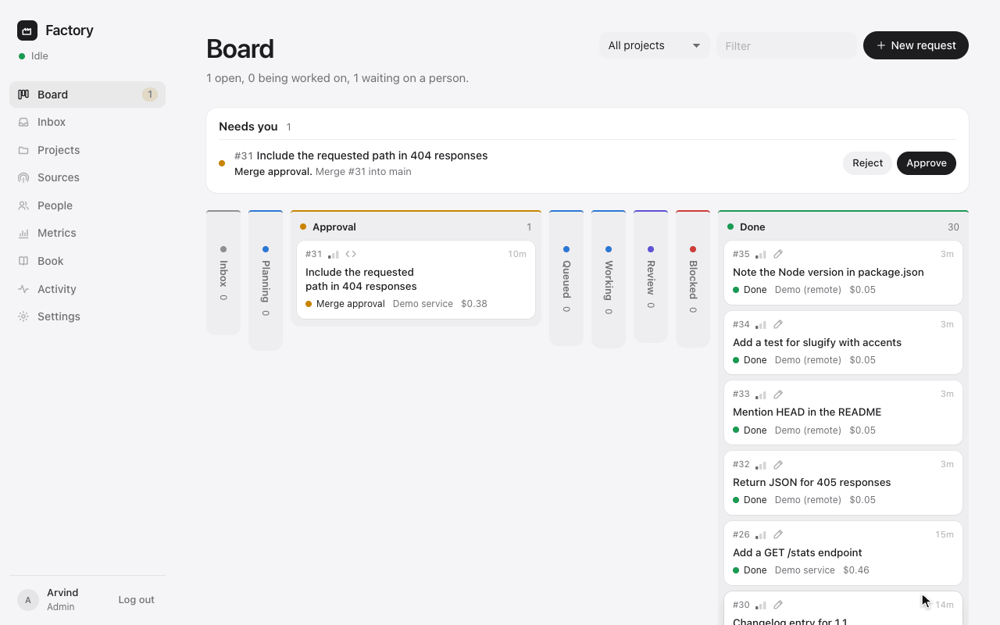
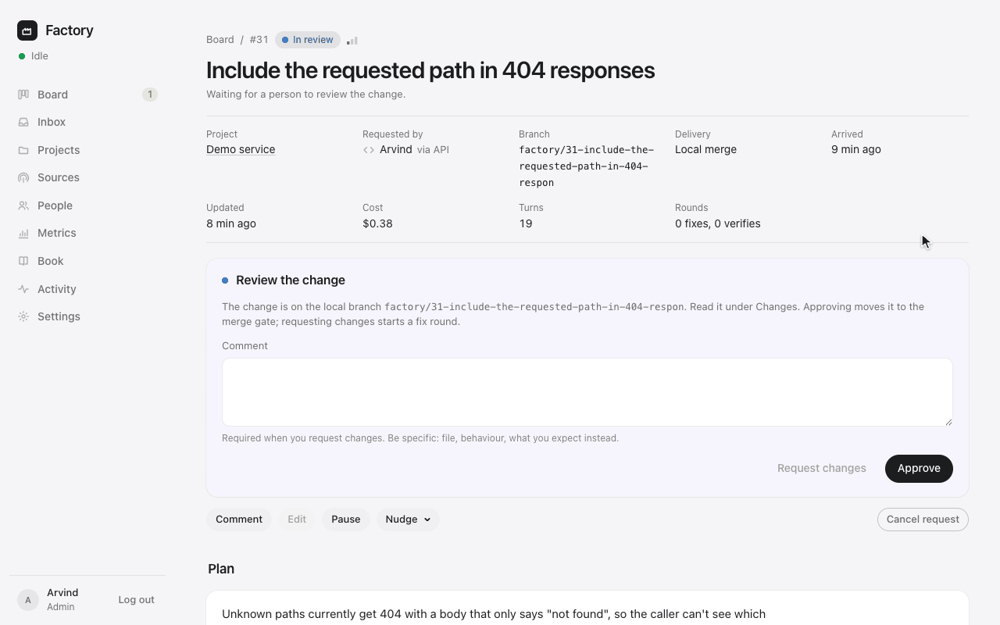
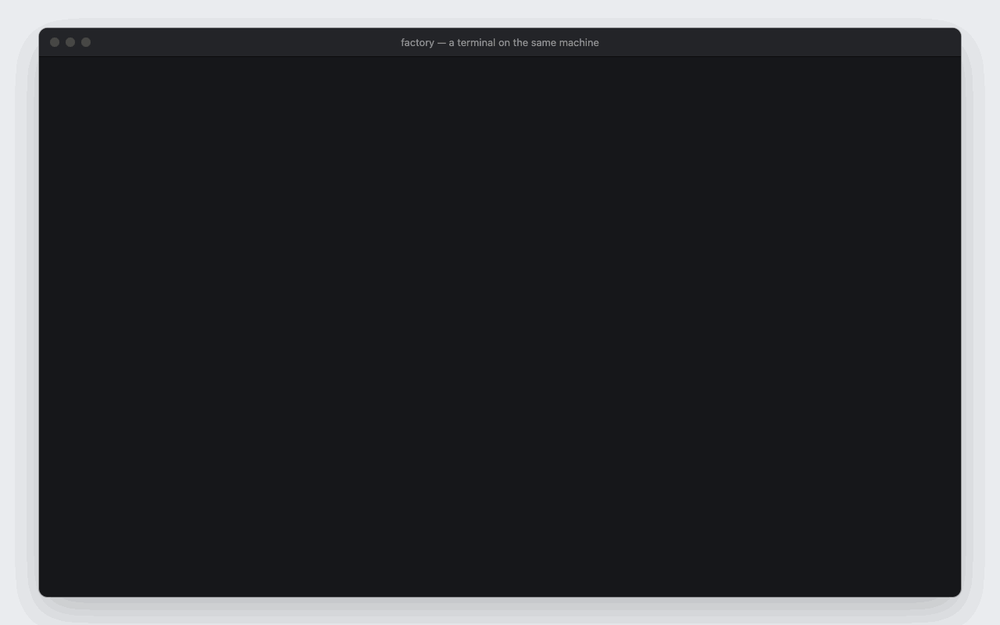

# Software Factory

Requests in, shipped changes out. Work arrives from wherever people already ask: a form, Slack,
Jira, GitHub issues, Linear, Telegram, a schedule, a watch on a running service, or a webhook.
Agents plan it, build it on its own branch, verify it, review it, merge it and deploy it. People
decide at the gates they choose to keep, and everyone can see live where every request is.
What a job teaches is written down for the next one.


*A real run on the demo service (item #26, $0.46). The quiet stretches are sped up and the wait
for the approval is cut.*

125 tests (`make check`) · Node 22.18+ · Postgres · no CI yet · no license file yet (the owner
will choose one)

## What it does

- **Takes work from where it is asked.** The form, the API and a CLI, Slack, Jira, GitHub issues,
  Linear, Telegram, schedules, watches on running services, webhooks. Status goes back to the same
  thread, ticket or issue.
- **Plans before it builds.** An agent reads the request and the repository, read-only, and writes
  a plan: kind, size, risk, steps, files, how it will be verified, what done means. If it cannot
  go on without answers, it asks its questions instead.
- **Builds in isolation.** Each job gets its own git worktree and branch, and an environment that
  holds no credentials. The factory itself runs the project's build and tests; a failure goes back
  to the same agent session as a fix round.
- **Gets a second opinion.** A second, cheaper agent reviews the diff against the plan. Then comes
  a pull request on GitHub, or the diff on the item page for a repository on the same machine.
  Review comments and failing checks become fix rounds too.
- **Leaves the decisions to people.** Each project sets its plan and merge gates to manual,
  automatic, or automatic only for low-risk plans, and its deploy gate to manual, automatic or
  off. Approve from the board, Slack, Telegram, a ticket comment or the CLI.
- **Shows everything, and remembers.** Every status change, line the agent wrote, tool call, test
  run and decision is an event on the item, streamed live to its page. There is a board, metrics
  and a daily digest. After each job a cheap model writes a note for *the book*, which later jobs
  read.

The agents sit behind an adapter. Today that is the **claude CLI** (`claude -p`) on the
machine's subscription login. The Codex and Gemini CLIs are wired in as well, and any other
harness is one file. Sign-in is Google.

## How a request moves



Fix rounds are capped per project (`maxFixRounds`). After the last one the item is **blocked**
and waits for a person. A merge that conflicts because the default branch moved is reconciled:
the base is merged into the job's branch, the agent resolves the conflicts, and the change is
verified again before it lands. Status goes back to the thread, ticket or issue the request
came from as it moves; questions, approvals, ready for review, done and blocked also go to
Telegram. Each step in full is in the [reference](docs/reference.md).

## Where work comes from, and where status goes

| from | how work arrives | where status goes |
|---|---|---|
| the form, the API, the CLI | **New request**; `POST /api/items` with an API token; `factory new` | the item page, Telegram |
| Slack | `@factory`, a DM, `/factory …`, or the trigger emoji on a message (Socket Mode: no public URL) | the thread, with Approve / Reject buttons |
| Jira | a JQL query, polled every minute (`labels = factory` by default) | comments on the issue; optional transition when done |
| GitHub issues | issues with a label, polled every minute | comments on the issue; pull requests are the review surface |
| Linear | issues with a label, polled | comments |
| Telegram | `/build <project> <request>` | the notifier's messages and buttons |
| schedule | cron or an interval: the same request each time | Telegram |
| watch | polls a URL and fires on a condition: a 5xx, a JSON number over a threshold, a phrase | Telegram |
| webhook | `POST /api/hooks/<token>` from CI, monitoring, anything | Telegram |

Replies in the thread and comments on the ticket count as answers and feedback. A comment of
`approve` or `reject` decides a gate. Tokens are encrypted at rest with `FACTORY_SECRET`. Every
kind of source is in the [reference](docs/reference.md), and how to connect each one is in
[setup](docs/setup.md).



## What a person does

- **Ask**: the New request form, `/factory …` in Slack, a `factory` label on a Jira, GitHub or
  Linear issue, `/build <project> <what>` on Telegram, `factory new` from a terminal, a webhook,
  the API.
- **Answer** a question the planner asked: reply in the thread, comment on the ticket, or comment
  on the item.
- **Approve or reject** a plan, a merge or a deploy: buttons in Slack and Telegram, a comment of
  `approve` or `reject` on Jira, GitHub or Linear, the board, or `factory approve <id>`.
- **Review** a change: approve or request changes on the pull request, or on the item page for
  local delivery. Comments become fix rounds.
- **Unblock**: retry, cancel, skip a gate, mark done, pause an item. A retried build starts a
  fresh run on the kept branch; a failed merge or deploy goes back to its gate. Admins can pause
  the whole factory.
- **Teach**: write in the book (the twelve newest notes go into every plan and build prompt), set
  a project's instructions. Admins tune its gates, limits and tools.

Roles are viewer, member and admin. Someone new waits as *pending* (or only looks, as a viewer,
if Settings says so) until an admin lets them in. Who may approve is a setting, and each chat or
ticket source can name who may decide from there
([who may do what](docs/reference.md)).

The board shows every request in its column, and **Needs you** on top lists what waits on a
person. Below, requests on a second demo project (the fake runner, no model) arrive, plan, queue,
build and land, while a real change waits for its merge approval:



On the item page, a change that waits for review shows the diff under **Changes**. **Runs** has
the exact prompt each agent was given, and **Messages** has everything said to the factory and
by it:



## Safety

- One worktree per job; the live checkout of a local project is never written by an agent.
- Agents cannot push, use `gh`, `sudo`, `ssh`, `docker`, `launchctl`, `kill`, or touch the machine; projects widen the allow list deliberately. Allowing a command by name (`Bash(kubectl get:*)`, `Bash(gcloud:*)`) lifts the factory's default block on it; pushing, `gh`, `git config`, `sudo` and shell wrappers (`sh -c`, `eval`, `xargs`) stay blocked whatever a project says.
- A project can also name folders its agents may read outside the worktree (never write), and MCP servers they may use (Claude runner). Factory runs never load the machine's own Claude Code MCP servers (`--strict-mcp-config`); **Copy from Claude Code** on the project's edit page copies the ones `claude mcp add` set up there, server-side. An MCP server's keys stay in its definition, which the CLI hands to the server process only; the project's environment is the agent's shell as well. The API shows them as `••••••`, and saving that back keeps the stored value. claude.ai connectors cannot be used: `claude -p` does not load them.
- Agents are told these rules up front, and a refused action is logged once per run with what would allow it, so a missing tool is a settings change rather than a guess.
- The agent's environment is an allow-list (PATH, HOME, git identity): no database URL, no OAuth secret, no SSH agent, no GitHub token, no API keys unless `CLAUDE_ENV_PASSTHROUGH` names them. The factory itself, not the agent, pushes and opens pull requests.
- What is *not* there: a sandbox. The CLI's file tools are confined to the worktree, but the allowed toolchain commands (`node`, `npm`, `python3`, `make`) run whatever code the repository holds, and an allowed shell command is not path-restricted. The toolchain can reach the network. The agent therefore has no stored git credentials, no `gh` login, no SSH identity and no API keys (its git talks to nothing), and the factory's own git never runs the repository's hooks. Keep `tools.mode` at `edit`, widen the allow list deliberately, and treat `full` as what it says.
- Projects (what runs on this machine) and sources (integrations and their tokens) are an admin's to create and change; members tune a project's words and model. On GitHub, only owners, members and collaborators of the repository steer the agent through pull-request comments; chat and ticket sources can name who may approve.
- Per run: `maxTurns`, `maxBudgetUsd`, `maxMinutes`, and a loop guard (the same tool call four times in a row stops the run). Per project: concurrency and review WIP. Factory-wide: `MAX_CONCURRENT_RUNS`, a **kill switch** (Settings › Pause), a **daily budget** (nothing new starts once today's API-equivalent spend reaches it), and a hold when the plan's five-hour window is past `usageThreshold` (the CLI reports it on every request).
- A restart marks running sessions interrupted and parks their items as blocked, with the branch and its commits kept; *Retry* starts the stage again from there (a build gets a fresh run on the kept branch; a merge or deploy goes back to its gate; a cancelled item is rebuilt, its branch is gone).
- **Pause the factory** refuses every new agent run at once: a job mid-stage stops at its next run and parks as blocked, to retry after resuming. The **daily budget** only stops the tick: a stage already under way finishes (its day is the database's day).
- Every event has an actor; what people change in projects, sources and people is audited.

## Run it

```sh
cp .env.example .env     # DATABASE_URL from ~/Self/dashboard/platform/db.sh url factory; FACTORY_SECRET; Google client; ADMIN_EMAILS
make db                  # the shared platform Postgres and the "factory" database
npm install
make deploy              # typecheck, build the UI, (re)start on http://127.0.0.1:8282
make launchd-install     # keep it running across logins (com.factory.web); rack shows it as software-factory/web
```

Node 22.18 or newer (25 on this Mac). The agent is the `claude` CLI: install it and log in once
(`claude`, then `/login`) as the user the factory runs as; Settings › Runners shows the version
it found. Changes to `.env` need `make deploy`. To try the whole loop without spending a token:
`DEMO_RUNNER=fake node demo/seed.ts` (with `DEV_LOGIN=1` in `.env`, or `FACTORY_TOKEN` set)
registers a tiny demo repository and files a first request; without `DEMO_RUNNER` it uses the
real agent.

`make dev` runs the API with reload on :8282 and Vite on :5282. `make check` typechecks and runs
the tests (end-to-end against `factory_test` with a fake runner; no model is called).

**On another machine.** The commands above assume the Mac this was built on. `make db` and
`make deploy` start Postgres from a shared Docker Compose file and create the database with its
`db.sh`, both in `PLATFORM_DIR` (default `~/Self/dashboard/platform`). `make deploy` then restarts
the server through launchd (`launchctl`) if the unit is installed, and otherwise as a background
process. `make launchd-install` writes a macOS LaunchAgent. `dashboard.json` registers the app
with rack, the local dashboard. **Add from this Mac** looks for checkouts under rack's roots
(`~/Self` when there are none), or in any folder an admin types, and Telegram goes through a separate notifier app (`NOTIFIER_URL`;
empty turns it off). None of this is needed elsewhere. The server needs Node 22.18+, git, an
agent CLI, and a Postgres it can reach at `DATABASE_URL` (it applies its migrations at boot); `gh`
is needed only for pull-request delivery. So on any machine: fill in `.env`, then
`npm install`, `npm run build`, `npm start`.

**First sign-in.** With `GOOGLE_CLIENT_ID`/`_SECRET` set and `<origin>/api/auth/google/callback`
registered on that OAuth client (`http://127.0.0.1:8282/api/auth/google/callback` for local use),
"Continue with Google" works. The addresses in `ADMIN_EMAILS` are admins; `ALLOWED_EMAILS` and
`ALLOWED_DOMAINS` are members; anyone else who signs in lands as *pending* and an admin lets them
in from **People**. With no admins named, the first account to sign in becomes the admin.
`DEV_LOGIN=1` adds a local email sign-in for development; it is refused through the proxy.

## The command line

```
FACTORY_URL=http://127.0.0.1:8282 FACTORY_TOKEN=ft_…   # a token from Settings › My API tokens
factory status                      factory new me "Dark mode for the gym page" --body -
factory ls --open                   factory watch 42        # follow a job live; exit code says how it ended
factory approve 42 "go"             factory review 42 changes "the test only covers the happy path"
factory comment 42 "use the existing Button"   factory cancel 42 · factory retry 42 · factory approvals · factory projects
```



*What the real CLI printed for item #31, replayed in a drawn terminal with the waits shortened.*

Exit codes: `0` ok, `4` a usage, API or network error. `factory watch` exits by how the item
ended: `0` done, `1` failed, `2` cancelled, `3` blocked (`4` if the CLI or the network gave up
first). Each command refuses flags it does not take; `review … changes` needs a comment;
`factory show --json` carries the whole event history. `make install-cli` puts `factory` on the
PATH.

## How it is built

| | |
|---|---|
| Server | `server/`: Hono on Node's native TypeScript (no build step), Postgres, four runtime dependencies. `lib/pipeline.ts` is the only thing that moves an item. Agents, intake and status are adapters: `lib/runners/`, `lib/sources/`, `lib/conversations.ts`. |
| Web | `web/`: React and Vite, served by the same process; item pages stream over server-sent events. |
| CLI | `cli/factory.ts`, no dependencies. |
| Ops | `ops/deploy.sh`, `ops/launchd.sh`, `dashboard.json`; `ops/record/` made the clips on this page. |
| Tests | `test/`: 125 tests, the whole pipeline end to end among them, on a temporary repository with the fake runner. |

The full code map is in the [reference](docs/reference.md), and the design in
[architecture](docs/architecture.md).

## Status

Proven on the machine it was built on:

- Eight real jobs through the `claude` runner (two of them side by side on two projects, two of
  them recorded for this page): planned, built, verified, reviewed by a second agent and merged,
  unattended or through a person's gate. Each took about a minute of agent time and cost
  $0.29–0.46.
- With the fake runner: local delivery, a non-GitHub remote (clone, push, review here, merge,
  push back), six concurrent jobs against the concurrency and review limits, merge conflicts
  resolved by a reconcile round, stage-aware retry, watch and schedule sources, pending-user
  onboarding, Telegram posts and buttons, the CLI.
- 125 automated tests (`make check`), a headless-browser click-through of every page
  (`node ops/clickthrough.cjs`), screenshots of every page (`node ops/shoot.cjs`).

Not proven, or not there:

- The Slack, Jira, Linear and GitHub-issue sources have not been run against a real account. The
  first connection may need a small fix.
- Pull-request delivery on GitHub has never run end to end. The code path is tested against a
  local remote; the GitHub-specific parts (`gh pr create`, reading reviews back, `gh pr merge`)
  are unexercised.
- The Codex and Gemini runners: only `--version` was checked.
- No automatic rollback after a bad deploy: the factory blocks the item and says so.
- No filesystem sandbox around agents (see [Safety](#safety)).
- No CI, and no license file yet.

## Docs

- [For teammates](docs/for-teammates.md): how to ask, answer and approve from every channel.
- [Setup](docs/setup.md): Google sign-in, a public hostname, the first project, each source, runners, budgets.
- [Reference](docs/reference.md): a request's life step by step, roles, project fields, sources, the CLI, the code map.
- [Architecture](docs/architecture.md): one process, the tick, runs, git, runners, sources, the security model.

## Research

Before the design there were four reports, with their sources inline:
[the market](docs/research/market-landscape.md) (who sells a "software factory" in 2026 and how
they take work in, report, cost and perform), [the operating model](docs/research/operating-model.md)
(how teams that run agents at scale structure the loop, and where it fails),
[the headless CLI](docs/research/claude-code-headless.md) (exactly how `claude -p` behaves without
a terminal), and [the integrations](docs/research/integrations.md) (Slack, Jira, GitHub, Linear,
webhooks, prompt injection). [The research index](docs/research/README.md) says what each one
changed in the design.
