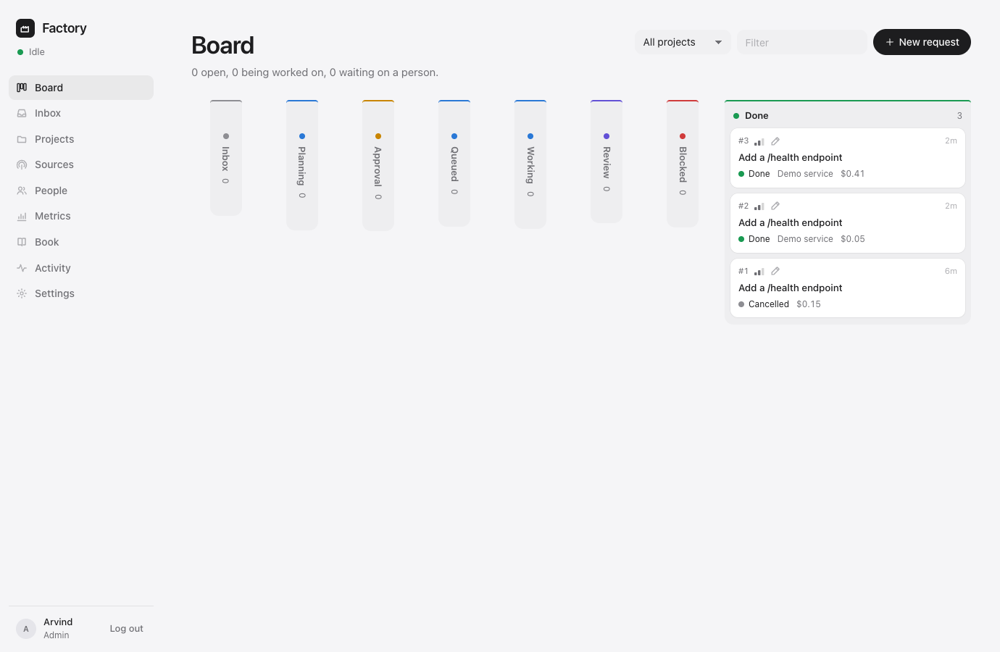
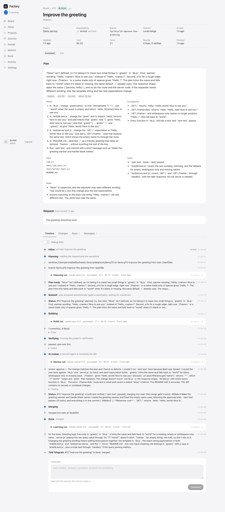

# Reference

The detail behind the [README](../README.md): how a request moves step by step, what everyone
sees, who may do what, every field of a project, every kind of source, the command line, and
where things are in the code. Setting each piece up is in [setup.md](setup.md); how the parts
fit together is in [architecture.md](architecture.md).

## A request's life

1. **Arrives** as a work item: title, request, project, priority, where it came from (its *origin*,
   which is where status goes back to). Items without a project wait in the inbox for someone to
   pick one.
2. **Plan.** An agent reads the request and the repository (read-only) and answers with a plan:
   summary, kind, size, risk, steps, files, how it will be verified, what "done" means — or the
   questions it cannot proceed without, in which case the item waits for an answer in the thread,
   the ticket, or the item page.
3. **Gate: plan.** Per project: `manual` (someone approves, from the board, Slack, Jira, GitHub,
   Telegram or the CLI), `auto`, or `auto_low_risk` (only high-risk plans wait).
4. **Build.** The agent works in a fresh **git worktree** on `factory/<id>-<title>`, with the
   project's toolchain allowed and pushing, credentials and the machine denied (the toolchain can
   still reach the network: `npm`, `node` and `python` do). It commits as it goes; whatever it
   leaves uncommitted is committed for it. It cannot ask questions: it decides, does, and reports.
5. **Verify.** The factory itself runs the project's `build_command` and `test_command`. A failure
   goes back to the same agent session as a fix round (resumed, so it remembers), up to
   `maxFixRounds`; then the item is **blocked** for a person.
6. **Review.** Optionally a second agent (a cheaper model) reads the diff against the plan and
   either approves or asks for changes (a fix round). Then: with delivery `pr`, the branch is
   pushed and a pull request opened through `gh`; reviews, comments, inline comments and failing
   checks on it flow back as feedback and fix rounds, an approval moves it on. With delivery
   `local` (a repository that lives on this Mac), the diff is reviewed in the factory and merged
   into the local checkout.
7. **Gate: merge**, then **merge** (squash through `gh pr merge`, or a local `--no-ff` merge). If the
   default branch moved while the job waited and the merge conflicts, the factory merges the base
   into the job's branch; conflicts go back to the agent as a fix round, verification runs again,
   and the change lands — up to `maxFixRounds` times before a person is asked.
8. **Gate: deploy**, then **deploy**: the project's `deploy_command` (`make deploy` for the apps on
   this Mac), followed by `health_url` until it answers 200, then watched for `observeMinutes`
   (a deploy that falls over a minute later is blocked, not done).
9. **Done.** A cheap model writes a note for **the book** — what was non-obvious, what to do
   differently — which goes into every later prompt for that project. The origin is told.

## What everyone sees

Every step is an event on the item: status changes, each line the agent said, each tool it ran
and what came back, test output, pushes, posts, approvals, feedback. The item page streams them
live; the board shows every item in its column; **Metrics** shows throughput, lead time, first-pass
rate, cost per shipped change, where time is spent, and what is waiting on a person. Once a day
(Settings › Daily digest) the factory posts a summary to Telegram and to Slack status channels:
the last 24 hours' arrivals, shipped and failed counts and cost, what shipped, and what waits on
a person and for what. A new account waiting to be let in is reported to Telegram once.





## Who may do what

Members ask, answer, comment, retry, cancel, pause an item, write in the book, and edit a
project's words and model. Approving and reviewing follow the "who may approve" setting (members,
or admins only); each chat or ticket source can also name who may decide from there. Admins change
gates, limits, tools and commands, create projects and sources, manage people, and hold the
factory-wide switches, **Pause the factory** included. Viewers only look.

## Projects

A project is a repository plus how to work in it. **Add from this Mac** (admins) lists the git
checkouts one level under rack's roots (say `~/code`, `~/code/labs`) that are not projects yet, with
the test, build and deploy commands it can read off `package.json`, the `Makefile`, `go.mod` or
`dashboard.json`. Its suggested setup copies the app's `.env` into each worktree so the tests can
reach their database — which means the agent can read that file; leave the copy out for apps
whose secrets it must not see.

| | |
|---|---|
| `repo_url` or `local_path` | a URL the factory clones into `data/repos/<slug>`, or a checkout already on this Mac (`~/code/my-app`). Jobs always run in worktrees; a local checkout is only touched by the merge. |
| `delivery` | `pr` (push, open a pull request, merge through GitHub) or `local` (review the diff here, merge into the checkout). |
| `setup_command`, `build_command`, `test_command`, `deploy_command`, `health_url` | run by the factory, not the agent: setup in each new worktree, build and test as the verify gate, deploy after merge. |
| `gates` | `plan` and `merge`: `manual` · `auto` · `auto_low_risk`; `deploy`: `manual` · `auto` · `off`; `review`: `ai` · `off`. With delivery `local` and an automatic merge gate, a verified (and, with `review: ai`, approved) change merges without waiting for a person; with delivery `pr` the pull request still needs its approval. |
| `limits` | `maxTurns`, `maxBudgetUsd` (API-equivalent, as the CLI reports it), `maxMinutes`, `maxFixRounds`, `concurrency`, `verifyMinutes`, `maxInReview` — builds stop starting when that many items of the project are waiting on reviewers — and `observeMinutes` after a deploy. A run that repeats the same tool call four times in a row is stopped as a loop. |
| `tools` | `mode` `readonly` · `edit` · `full`, plus `allow` / `deny` rules in the CLI's syntax (`Bash(docker:*)`). The defaults allow the usual toolchains and deny pushing, `gh`, `sudo`, `ssh`, `docker`, `launchctl`, `kill` and friends. |
| `runner`, `model`, `effort` | which adapter and model does this project's work. |
| `instructions` | appended to every prompt for this project. The repository's own `CLAUDE.md` applies as well. |
| `env` | extra variables for the agent and the commands (names shown, values kept). |

## Sources

| kind | how it gets work | how status goes back |
|---|---|---|
| `manual` / `api` | the form; `POST /api/items` with an API token | the item page, Telegram |
| `slack` | Socket Mode (no public URL needed): an `@mention`, a DM, `/factory <text>` (`/factory status` too), or the source's trigger emoji on a message (`:factory:` by default, a custom emoji you add, or `:robot_face:`); replies in the thread are answers and feedback; 👀 is the factory's acknowledgement | messages in the thread, with Approve / Reject buttons |
| `jira` | polls a JQL every minute (`labels = factory AND statusCategory != Done`); new comments are feedback; `approve` / `reject` comments decide gates | comments on the issue; optional transition when done |
| `github` | polls issues with a label every minute (a token with Issues read & write, or the `gh` login on this Mac); comments are feedback | comments on the issue; PRs are the review surface, always through `gh` |
| `linear` | polls issues with a label | comments |
| `schedule` | cron or interval: the same request each time (nightly log triage, weekly dependency bump); one open at a time | Telegram |
| `watch` | polls a URL and fires on a condition (a 5xx, a JSON number over a threshold, a phrase in the body) — the loop from running software back to work | Telegram |
| `webhook` | `POST /api/hooks/<token>` with `{title, body, …}` from CI, monitoring, anything | Telegram |
| Telegram | `/build <project> <request>`, `/factory`, `/approvals`, through the notifier | the notifier's buttons |

Secrets (tokens) are encrypted at rest with `FACTORY_SECRET`. Set-up details for each are in
[setup.md](setup.md).

## The command line

```
FACTORY_URL=http://127.0.0.1:8282 FACTORY_TOKEN=ft_…   # a token from Settings › My API tokens
factory status                      factory new me "Dark mode for the gym page" --body -
factory ls --open                   factory watch 42        # follow a job live; exit code says how it ended
factory approve 42 "go"             factory review 42 changes "the test only covers the happy path"
factory comment 42 "use the existing Button"   factory cancel 42 · factory retry 42 · factory approvals · factory projects
```

Exit codes: `0` ok, `4` a usage, API or network error. `factory watch` exits by how the item
ended: `0` done, `1` failed, `2` cancelled, `3` blocked (`4` if the CLI or the network gave up
first). Each command refuses flags it does not take; `review … changes` needs a comment;
`factory show --json` carries the whole event history.

`make install-cli` puts `factory` on the PATH (`~/.local/bin`); `factory --help` lists every command and flag.

## Code map

| | |
|---|---|
| Server | `server/`, Hono on Node's native TypeScript, Postgres (`factory` in the platform's instance). `lib/pipeline.ts` is the floor: the tick, the stages, the gates, what comes back. `lib/items.ts` the items, approvals, feedback, runs. `lib/runners/` the agent adapters (`claude`, `codex`, `gemini`, `fake`). `lib/sources/` the intake adapters and their scheduler. `lib/git.ts` worktrees, pushes, PRs, merges. `lib/prwatch.ts` reads pull requests back. `lib/conversations.ts` posts status to origins and Telegram. `lib/prompts.ts` every prompt and schema. `lib/auth.ts` Google sign-in, roles, sessions, API tokens. `routes/` the API. |
| Web | `web/`, React + Vite, served by the API: the board, item pages streaming over SSE, projects, sources, people, metrics, the book, settings. |
| CLI | `cli/factory.ts`. |
| Ops | `ops/deploy.sh` (what rack's Deploy button runs), `ops/launchd.sh`, `dashboard.json`; `ops/shoot.cjs` (screenshots of every page) and `ops/clickthrough.cjs` (a click-through of the main flows) in headless Chrome; `ops/record/` (the clips in the README: `hero.cjs`, `board.cjs`, `review.cjs`, `cli-capture.cjs` and `cli.cjs`, `sources.cjs`, and `encode.cjs`, which turns their frames into a GIF and an MP4). |
| Tests | `test/`: cron, crypto, Google token verification, the stream parser, items, and the whole pipeline end to end on a temporary repository with the fake runner. |
